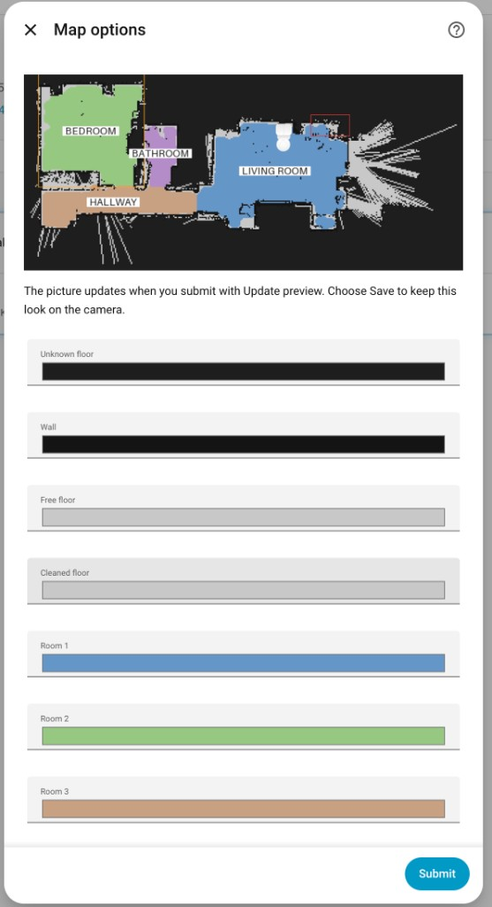
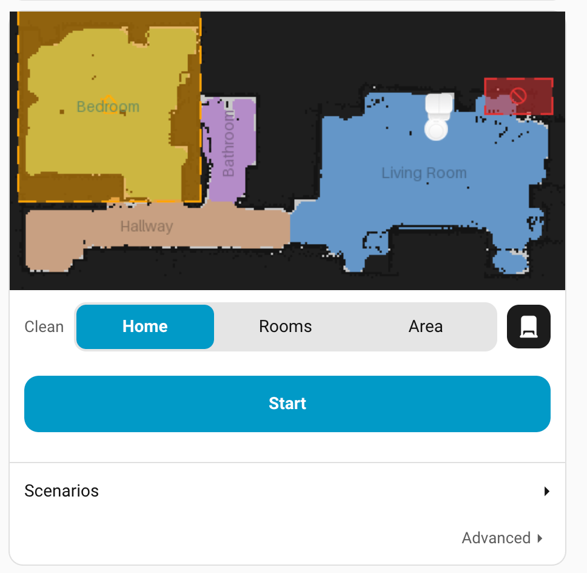

# Eufy Clean for Home Assistant

[](https://github.com/hacs/integration)
[](https://github.com/albertoxamin/eufyhome/releases)
[](https://github.com/albertoxamin/eufyhome/commits/main)

A Home Assistant custom integration for Eufy robot vacuums. This integration is based on the [Homey Eufy Clean integration](https://github.com/martijnpoppen/com.eufylife.home) and uses the [eufy-clean SDK](https://github.com/martijnpoppen/eufy-clean).

## Features

- Start, stop, pause, and return to dock
- Battery, work status, work mode, and errors
- Fan speed: quiet, standard, turbo, max
- Mopping on compatible models: clean type, water level, and intensity
- A map camera, plus a dashboard card for rooms, areas, zones, and driving

## Setup

Do these in order. The first time takes about 10 minutes.

### 1. Install

**HACS**

1. Open HACS, then Integrations.
2. Open the three dots and choose Custom repositories.
3. Add `https://github.com/albertoxamin/eufyhome` and set the category to Integration.
4. Search for Eufy Clean and install it.
5. Restart Home Assistant.

**Manual**

1. Download the latest release.
2. Copy `custom_components/eufy_clean` into your Home Assistant `custom_components` folder.
3. Restart Home Assistant.

### 2. Add your account

1. Go to Settings, then Devices & Services.
2. Choose Add Integration and search for Eufy Clean.
3. Enter the email and password from the Eufy Clean app.
4. Wait until your vacuums show up. Each one gets a vacuum, a Map camera, sensors, and the controls in step 6.

Two-factor accounts are not supported. Use the same login that works in the Eufy app.

### 3. Store the map

The map camera stays empty until the robot has sent a floor once.

1. Open the Eufy Clean app on your phone.
2. Open the vacuum and view the map. Leave it on screen for a few seconds.
3. In Home Assistant, open the Map camera. The rooms, dock, robot, and path should appear.

That view is what sends the floor. Home Assistant stores it, so the picture is still there after a restart. Later updates arrive on their own. You do not need the app open again unless the camera goes blank.


The camera shows rooms, the dock, the robot, and the cleaning path. Room names stay upright. A name turns 90 degrees when the room is narrower than the text. No-go zones are a half-transparent red fill with a dashed edge. No-mop zones are the same in orange. While the robot is cleaning, the path is solid. Trips and the return to the dock are dotted.

### 4. Configure the map

1. Go to Settings, then Devices & Services, then Eufy Clean.
2. Open Configure on the integration.
3. Change the options below. The picture at the top is a live preview.
4. Set **When you submit** to Update preview and submit. The preview redraws.
5. When it looks right, set **When you submit** to Save and submit. That look is what the camera and the card use.



**Layout**

| Option | What it does | Default |
| --- | --- | --- |
| Clockwise rotation | Turns the whole picture. Choices are 0, 90, 180, and 270. | 90 |
| Icon size | Dock, robot, and zone marks. Range 0.01 to 2. | 0.5 |
| Render multiplier | Sharper picture. Range 1 to 4. | 2 |
| Max pixels | Longest side of the preview. Range 128 to 1024. | 512 |
| Label size | Room-name text. Range 8 to 22. | 8 |

Room names use a darker version of that room's color. Label text and Label plate are in the form and do not change the picture.

**Colors**

| Option | What it paints |
| --- | --- |
| Unknown floor | Area outside the rooms |
| Wall | Walls |
| Free floor | Floor the robot can cross |
| Cleaned floor | Floor already covered |
| Room 1 to Room 8 | One color per room, in room-id order |
| Path color | The cleaning trail |

**Path**

| Option | What it does | Default |
| --- | --- | --- |
| Path opacity | How solid the trail is. Range 0 to 1. | 0.5 |
| Path style | Segmented, Dotted, or Solid. Segmented is solid while cleaning and dotted on trips. | Segmented |
| Path width | Line thickness. Range 1 to 8. | 2 |
| Path spacing | Gap in a dotted or dashed trail. Range 0.25 to 8. | 1 |
| Embedded path | Path stored inside the map download. | On |
| Preview path | Live trail drawn on top. | On |
| Embedded dot size | Size of dots baked into the map. Range 0.2 to 4. | 1.9 |

**What is drawn**

| Option | Default |
| --- | --- |
| Room names | On |
| No-go zones | On. This also draws no-mop zones. |
| Dock | On |
| Robot marker | On |
| Robot | Dot. Googly is the other choice. |
| Status badge | None. Other choices are Charging, Washing, Drying, and Emptying. |

### 5. Add the map card

The card is registered when the integration starts. Restart Home Assistant once after installing, then:

1. Edit a dashboard and choose Add card.
2. Search for Eufy Clean Map.
3. Set the camera to your Map camera, for example `camera.omni_map`.
4. Set the vacuum to your robot, for example `vacuum.omni`.

Or paste this card. Use your own entity ids.

```yaml
type: custom:eufy-clean-map-card
camera: camera.omni_map
vacuum: vacuum.omni
```



**Clean.** The row next to the map chooses what Start does.

1. Home starts a full-home clean.
2. Rooms: tap rooms in the order you want them cleaned. A number badge shows that order. Tap a room again to drop it. Each selected room can be Vacuum, Mop, or Both, with its own suction and mop level.
3. Area: drag a rectangle on the map. That rectangle can be Vacuum, Mop, or Both.

Vacuum hides the mop level. Mop hides suction. Both shows both.

**Station.** The black square on the right opens Wash mop, Dry mop, Empty dust, and Stop.

**Scenarios.** Opens the list stored on the robot. Tap one to start it. The same scenarios also exist as Home Assistant scenes.

**Advanced.** Closed until you open it.

1. Edit zones turns on No-go, No-mop, Delete, and Save. Drag on the map to draw a rectangle, then Save. Delete removes the zone you tap. Closing Advanced leaves this mode.
2. The arrows drive the robot. Hold one to keep moving. Letting go brakes. Down drives backward.

### 6. Device controls

These are on the device page. The card covers cleaning, zones, the station, and driving. Use these when you want a switch or a sensor in an automation.

**Selects.** Clean Type, Mop Water Level, and Clean Intensity appear on mopping models. Clean Room picks one room by name. Start the vacuum after you pick it.

**Switches.** Do Not Disturb, BoostIQ, Auto Empty, and Auto Wash Mop.

**Volume.** A number entity.

**Buttons.** Locate, Wash Mop, Dry Mop, Empty Dust Bin, and Stop Station.

**Sensors.** Work status, work mode, clean speed, error, station activity, dock status, and consumable usage.

## Supported Devices

This integration supports a wide range of Eufy robot vacuums, including:

- RoboVac 11C, 11S
- RoboVac 15C MAX
- RoboVac 25C
- RoboVac 30C, 30C MAX
- RoboVac 35C
- RoboVac G10 Hybrid, G20, G20 Hybrid
- RoboVac G30, G30 Verge, G30 Hybrid, G30+ SES
- RoboVac G32, G35, G35+
- RoboVac G40, G40 Hybrid, G40 Hybrid+
- RoboVac G50
- RoboVac L60, L60 Hybrid, L60 SES, L60 Hybrid SES
- RoboVac L70 Hybrid
- RoboVac LR20, LR30 Hybrid, LR30 Hybrid+, LR35 Hybrid, LR35 Hybrid+
- RoboVac X8, X8 Hybrid, X8 Pro, X8 Pro SES
- RoboVac X9 Pro
- RoboVac X10 Pro Omni
- RoboVac S1
- RoboVac C10, C20
- RoboVac E20, E25, E28
- And more...

## Entities

### Vacuum Entity

The main vacuum entity provides the following features:

- **State**: Current state (cleaning, docked, returning, idle, error)
- **Battery Level**: Current battery percentage
- **Fan Speed**: Current cleaning intensity

#### Services

- `vacuum.start`: Start cleaning
- `vacuum.pause`: Pause cleaning
- `vacuum.stop`: Stop cleaning
- `vacuum.return_to_base`: Return to dock
- `vacuum.set_fan_speed`: Set fan speed (quiet, standard, turbo, max)
- `vacuum.locate`: Make the vacuum beep to help locate it

#### Room Cleaning Service

- `eufy_clean.clean_rooms`: Clean specific rooms by their IDs

**Example service call:**
```yaml
service: eufy_clean.clean_rooms
target:
  entity_id: vacuum.omni
data:
  room_ids: "[1, 2]"  # or "1, 2" for comma-separated
  clean_times: 1
```

**Finding room IDs:** open the vacuum or the Map camera and read the `rooms` attribute. Each entry has an `id` and a `name`. The card uses those names, so you only need the ids for an automation.

Other actions the card uses, if you want them in an automation:

- `eufy_clean.clean_area` cleans a rectangle. `x1`, `y1`, `x2`, and `y2` are fractions of the picture, from 0 to 1. Optional `kind` is `vacuum`, `mop`, or `both`.
- `eufy_clean.clean_square` cleans a square. `x` and `y` are the centre in centimetres. `size` is the side, from 50 to 2000.
- `eufy_clean.set_zones` replaces no-go and no-mop rectangles. Virtual walls stay.
- `eufy_clean.start_scene` starts a scenario by `scene_id`.
- `eufy_clean.station` takes `action`: `wash`, `dry`, `empty`, or `stop`.
- `eufy_clean.remote_move` takes `direction`: `forward`, `back`, `left`, `right`, or `brake`.

### Sensor Entities

- **Work Status**: Current work status (cleaning, charging, standby, etc.)
- **Work Mode**: Current work mode (auto, room, spot, etc.)
- **Clean Speed**: Current fan speed setting
- **Error**: Current error code (if any)

### Binary Sensor Entities

- **Charging**: Whether the vacuum is currently charging
- **Docked**: Whether the vacuum is currently docked

### Button Entities

- **Locate**: Make the vacuum beep to help locate it

### Select Entities (Mopping Models Only)

- **Clean Type**: Choose between Sweep Only, Mop Only, or Sweep and Mop
- **Mop Water Level**: Set the water level for mopping (Low, Medium, High)
- **Clean Intensity**: Set cleaning intensity (Standard, Deep Clean, Quick Clean)

### Camera Entity

- **Map**: the floor picture. Setup step 3 stores the first one. Setup step 4 changes how it looks.

## Troubleshooting

### Cannot connect to Eufy servers

- Make sure you're using the correct email and password
- Check that your Eufy account is working in the official Eufy Clean app
- Some accounts may require 2FA which is not currently supported

### Device not found

- Make sure your vacuum is online and connected to WiFi
- Try power cycling your vacuum
- Ensure the vacuum is visible in the Eufy Clean app

### Map camera stays blank

1. Open the Eufy Clean app.
2. Open that vacuum and view the map. Leave it on screen for a few seconds.
3. Reload the Map camera in Home Assistant.

The first floor is stored only after that view. Later restarts reuse the saved picture.

## Development

Linting and formatting use [Ruff](https://docs.astral.sh/ruff/). Configuration is in `pyproject.toml`.

```bash
# Install dev dependencies (optional)
pip install -e ".[dev]"

# Check lint and format
ruff check custom_components scripts
ruff format --check custom_components scripts

# Auto-fix and format
ruff check custom_components scripts --fix
ruff format custom_components scripts
```

## Credits

This integration is based on the work of:

- [Martijn Poppen](https://github.com/martijnpoppen) - Original Homey integration and eufy-clean SDK
- [jeppesens/eufy-clean](https://github.com/jeppesens/eufy-clean) - MQTT P2P map stream logic (`biz/` protocol-41 parsing, protobuf schemas, and map rendering)
- The Home Assistant community

## License

This project is licensed under the MIT License - see the [LICENSE](LICENSE) file for details.

## Disclaimer

This integration is not affiliated with or endorsed by Eufy or Anker. Use at your own risk.
